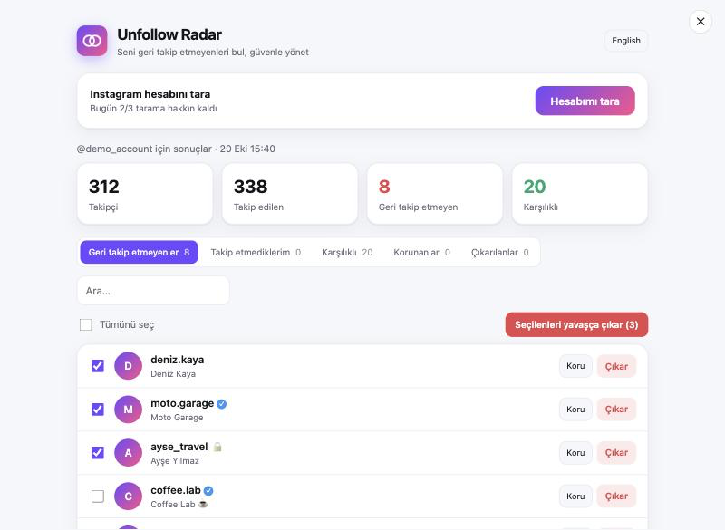
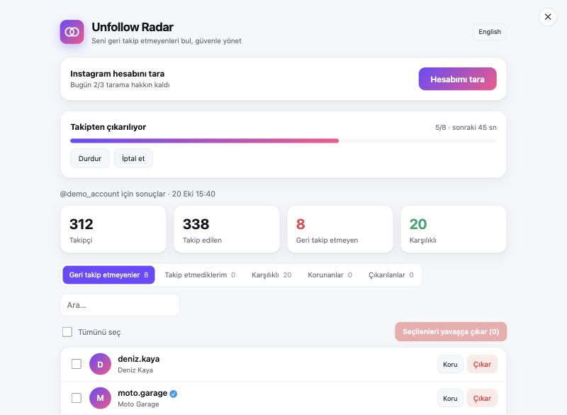
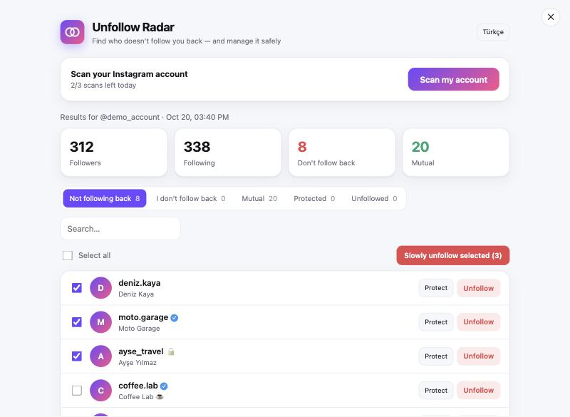
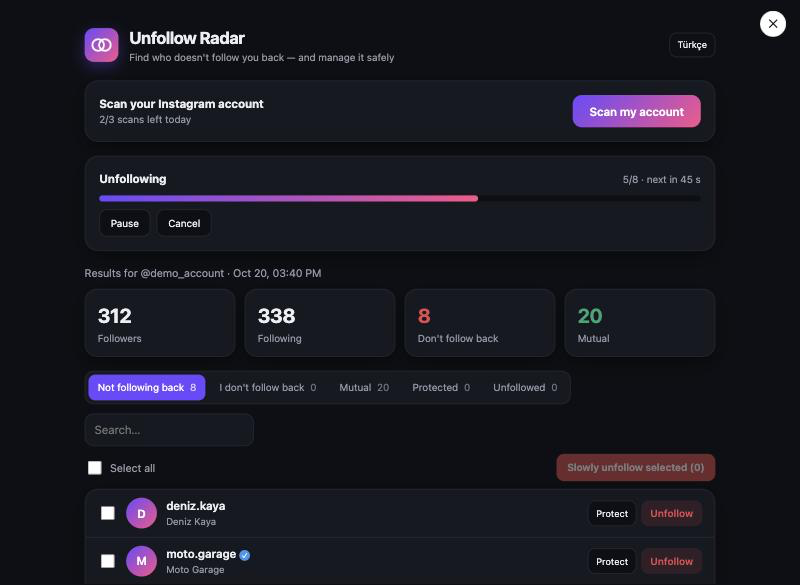

# 📡 Unfollow Radar

**Instagram'da seni geri takip etmeyenleri bul.** 
**Find who doesn't follow you back on Instagram.**

👇 **Dilini seç · Pick your language**

---

<h2>🇹🇷 Türkçe</h2>

Tek bir dosyayı tarayıcı konsoluna yapıştır, hepsi bu. **Kurulum yok, hesap yok, sunucu yok.**

### 🚀 Nasıl kullanılır
1. 🌐 [instagram.com](https://www.instagram.com)'u aç ve giriş yap.
2. ⌨️ **F12** → **Console** sekmesi. *(Chrome bir kez `allow pasting` yazmanı isteyebilir.)*
3. 📋 [`unfollow-radar.js`](unfollow-radar.js) dosyasını aç → **Raw** → hepsini kopyala → konsola yapıştır → **Enter**.
4. 🔍 Açılan panelde **Hesabımı tara**'ya bas.

### ✨ Özellikler
- 🔎 **Geri takip etmeyenler**, takip etmediklerin ve karşılıklı olanlar — profil resmi, arama ve ✓ / 🔒 işaretleriyle
- 🐢 **Yavaş toplu takipten çıkarma:** seç, kuyruğa ekle; durdur / devam / iptal et
- 🛡️ **Koru:** takipte kalacağın hesapları işaretle, toplu çıkarmaya girmesin (dışa/içe aktarılabilir)
- ⛔ **Otomatik fren:** Instagram engel koyarsa kuyruk kendiliğinden durur
- 📅 **Günlük sınır:** en fazla 3 tarama, 30 çıkarma
- 🌗 Türkçe / İngilizce, açık / koyu tema
- 🔒 Her şey tarayıcında kalır, hiçbir yere veri gitmez

### 📸 Ekran görüntüleri
| Sonuçlar | Kuyruk |
|:---:|:---:|
|  |  |

🛡️ <b>Hesabımı nasıl korur?</b>

 

Bekleme ve yeniden deneme kuralları [InstagramUnfollowers](https://github.com/davidarroyo1234/InstagramUnfollowers) varsayılanlarını izler:

- ⏱️ Kişiler arası **4–4,8 sn**, her 5 kişide ek **5 dk** mola
- 📄 Taramada sayfalar arası bekleme, her 15 istekte uzun uyku
- 🔁 Hata olursa en fazla 3 kez, artan beklemeyle yeniden dener

Bu projeye özgü ek korumalar:
- ⛔ Engel ya da **üst üste 2 başarısız işlem** → kuyruk durur
- 🔐 Tarama **eksik** görünürse çıkarma kilitlenir (yanlış kişi çıkarılmaz)
- ♻️ Yarım kalan tarama kaldığı yerden sürer
- ✅ Günlük tarama hakkı yalnızca başarılı taramada düşer

Tüm sayılar tek dosyada: [`src/shared.js`](src/shared.js)

🔒 <b>Verilerim nereye gidiyor?</b>

 

Hiçbir yere. Sonuçlar, korunanlar ve geçmiş sayfanın `localStorage` alanında (`unfollowRadar:` ile başlayan anahtarlar) durur. Paneldeki **Tüm verilerimi sil** hepsini kaldırır.

❓ <b>Çalışmazsa?</b>

 

- Eski sürümü yapıştırdıysan sayfayı yenileyip tekrar yapıştır.
- Instagram sitesini değiştirdiğinde araç bozulabilir; resmi olmayan uç noktalara dayanır.
- Sorunu [Issues](https://github.com/yigitbuyukeren/unfollow-radar/issues) üzerinden bildir.

### ⚠️ Dikkat
Instagram ile bağlantılı değildir. Otomasyon Instagram'ın kullanım şartlarına aykırı olabilir ve hesabın kısıtlanmasına yol açabilir. **Sorumluluk sana aittir.** Yalnızca okuyup güvendiğin kodu yapıştır — kaynaklar [`src/`](src) içinde.

### 📜 Açık kaynak ve lisans
Bu proje **açık kaynaktır** ve **[MIT lisansı](LICENSE)** ile yayınlanır: kullanabilir, değiştirebilir, dağıtabilir ve ticari işte bile kullanabilirsin. Tek şart, lisans ve telif notunu korumaktır. Yazılım "olduğu gibi" sunulur, garanti verilmez.

🤝 Katkılar memnuniyetle karşılanır: hata bildir, fikir öner ya da pull request aç. ⭐ Beğendiysen yıldız vermeyi unutma!

<h2>🇬🇧 English</h2>

Paste one file into your browser console and you're done. **No install, no account, no server.**

### 🚀 How to use
1. 🌐 Open [instagram.com](https://www.instagram.com) and sign in.
2. ⌨️ Press **F12** → **Console**. *(Chrome may ask you to type `allow pasting` once.)*
3. 📋 Open [`unfollow-radar.js`](unfollow-radar.js) → **Raw** → copy everything → paste into the console → **Enter**.
4. 🔍 In the panel that opens, press **Scan my account**.

### ✨ Features
- 🔎 **Not following back**, I don't follow back and mutuals — with profile pictures, search and ✓ / 🔒 badges
- 🐢 **Slow bulk unfollow:** select, queue; pause / resume / cancel
- 🛡️ **Protect:** mark accounts to keep so bulk unfollow skips them (export / import)
- ⛔ **Auto brake:** the queue stops by itself if Instagram blocks the action
- 📅 **Daily limits:** max 3 scans, 30 unfollows
- 🌗 Turkish / English, light / dark theme
- 🔒 Everything stays in your browser; nothing is sent anywhere

### 📸 Screenshots
| Results | Queue (dark) |
|:---:|:---:|
|  |  |

🛡️ <b>How does it protect my account?</b>

 

Waits and retry rules follow the defaults of [InstagramUnfollowers](https://github.com/davidarroyo1234/InstagramUnfollowers):

- ⏱️ **4–4.8 s** between people, plus a **5 min** break after every 5
- 📄 Waits between pages while scanning, a longer sleep every 15 requests
- 🔁 Retries up to 3 times with growing waits

Extra protections specific to this project:
- ⛔ A block, or **2 failed actions in a row** → the queue stops
- 🔐 If the scan looks **incomplete**, unfollowing is locked (the wrong people are never removed)
- ♻️ An interrupted scan resumes where it left off
- ✅ A daily scan is only counted when it succeeds

All numbers live in one file: [`src/shared.js`](src/shared.js)

🔒 <b>Where does my data go?</b>

 

Nowhere. Results, protected accounts and history stay in the page's `localStorage` (keys starting with `unfollowRadar:`). **Delete all my data** in the panel removes everything.

❓ <b>Not working?</b>

 

- If you pasted an older version, reload the page and paste again.
- Instagram can change its site at any time and break the tool; it relies on unofficial endpoints.
- Report problems in [Issues](https://github.com/yigitbuyukeren/unfollow-radar/issues).

### ⚠️ Warning
Not affiliated with Instagram. Automation may violate Instagram's terms and can get your account restricted. **Use at your own risk.** Only paste code you have read and trust — the sources are in [`src/`](src).

### 📜 Open source & license
This project is **open source**, released under the **[MIT License](LICENSE)**: you may use, modify, distribute and even use it commercially. The only condition is keeping the license and copyright notice. The software is provided "as is", without warranty.

🤝 Contributions are welcome: report bugs, suggest ideas or open a pull request. ⭐ If you like it, give it a star!

---

Built with ❤️ · Safety defaults inspired by <a href="https://github.com/davidarroyo1234/InstagramUnfollowers">InstagramUnfollowers</a> (MIT) · <code>npm run build</code> bundles <code>src/</code> into <code>unfollow-radar.js</code>

